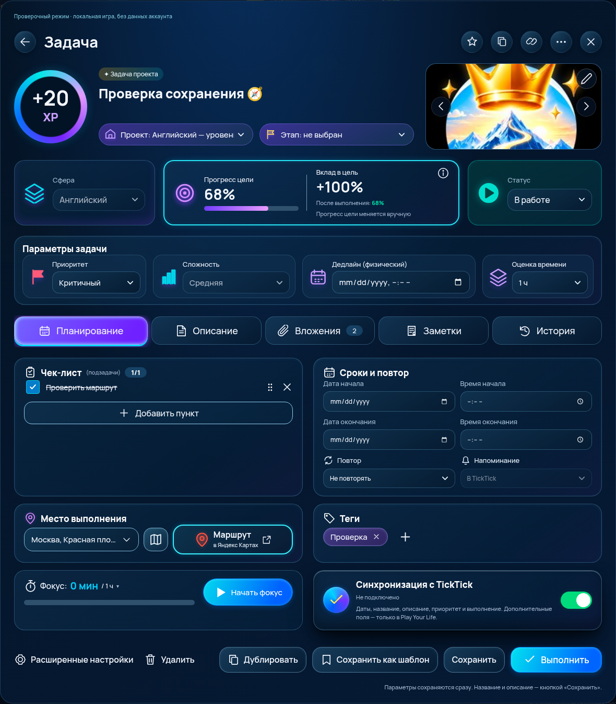
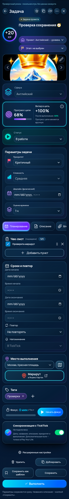

# Сверка кнопок с утверждённым изображением

11 ноября 2026. По отдельному поручению Ивана «Проверь по дизайну каждую кнопку с макетом». Визуальная сверка выполнена по изображению в чате; исходного файла/Figma и автоматического попиксельного diff нет. Используется существующий обязательный шрифт приложения Manrope. Ниже проверены все типы видимых элементов управления на вкладке «Планирование», а также дополнительные действия.

## Верхняя панель и шапка

| Элемент | Что сверено и исправлено | Поведение/состояния |
| --- | --- | --- |
| Назад | Круг 42 px, тёмное стекло, белая SVG-стрелка вместо символа | Закрытие с защитой черновика |
| Избранное | Тот же круг, контурная звезда; выбранная — золотая | Включение/выключение проверено в UI |
| Дублирование сверху | Две смещённые страницы SVG, одинаковый размер круга | Новая независимая задача; проверено |
| Копирование ссылки | SVG-цепочка вместо текстового символа | Существующий clipboard с текстовым fallback |
| Дополнительное меню | Три точки SVG и тот же круг; меню не наследует ширину круглой кнопки | Реальные пункты истории/переноса/экспорта; Escape закрывает меню |
| Закрыть | Белый SVG-крест, круг 42 px | Проверка несохранённого текста |
| Проект | Сине-фиолетовая капсула, иконка дома, белый шеврон; подпись «Проект» | Существующие проекты, сохранение/перезагрузка проверены |
| Этап | Такая же капсула, жёлтый флаг, белый шеврон | Только этапы выбранного проекта; без проекта отключён |
| Изменить обложку | Тёмный круг 39 px с SVG-карандашом в правом верхнем углу | Меню загрузки, выбора фото, первого изображения TickTick, удаления |
| Предыдущая обложка | Тёмный круг поверх изображения и белый шеврон | Появляется только при нескольких реальных сохранённых изображениях; проверено |
| Следующая обложка | Симметрично предыдущей | Переключение и сохранение выбора проверены; выполненная задача не редактируется |
| Открыть изображение | Всё изображение является кнопкой без рамки | Полноразмерный просмотр сохранённой копии; оригиналы больших файлов не хранятся |

## Информация и параметры

| Элемент | Сверка | Состояния/ограничения |
| --- | --- | --- |
| Сфера | Синий контур и капсула; иконка слоёв | Одно поле; сфера проекта и блокировка награды сохраняются |
| Информация/вес | Белый круг с `i` SVG справа от вклада | Компактный prompt веса. Состояние этого диалога в референсе не показано |
| Статус | Зелёно-бирюзовая капсула, круг с заполненным треугольником | Запланирована/в работе/на паузе/выполнена; возврат в выбранный рабочий статус проверен |
| Приоритет | Жёлтый заполненный флаг, капсула со шевроном | Низкий — зелёный, средний — жёлтый, высокий — оранжевый, критичный — красный |
| Сложность | Заполненные бирюзовые столбцы и выпадающее поле | Сохранена фиксация сложности. XP не продублирован вне основного индикатора |
| Физический дедлайн | Фиолетовый календарь слева; контур и скругление поля | Нативный календарь браузера, не второй независимый срок |
| Оценка времени | Фиолетовые слои и полноценный dropdown, как в макете | Минуты/часы, готовые значения и собственное время; значение 60 мин показывается как «1 ч» |

## Вкладки

| Кнопка | Результат сверки |
| --- | --- |
| Планирование | Более широкая первая кнопка, календарь, сине-фиолетовый градиент, голубой нижний край и свечение активного состояния |
| Описание | SVG-лист с загнутым углом вместо списка/текстового символа |
| Вложения | Наклонённая SVG-скрепка вместо цепочки; реальный счётчик |
| Заметки | SVG-блокнот с закладкой |
| История | SVG-часы со стрелкой возврата |

Все пять вкладок переключают только нижнюю область. Неактивные — тёмное стекло с тонким контуром. На телефоне полоса прокручивается; горизонтальной прокрутки всей страницы нет.

## Планирование

| Элемент | Что приведено к образцу | Проверка/ограничение |
| --- | --- | --- |
| Чекбокс пункта | Прозрачный тёмный квадрат с белым контуром; выполненный — голубой с белой галочкой | Отметка/возврат работают; нативная семантика checkbox сохранена |
| Текст пункта | Убрана лишняя рамка обычного input | Редактируется; у выполненного зачёркивается |
| Перетаскивание | Шесть SVG-точек справа | Drag-and-drop и действие «вверх» для клавиатуры/телефона |
| Удалить пункт | Неброский крест, виден при hover/focus и постоянно на сенсорном экране | Реальное удаление |
| Добавить пункт | Одна широкая контурная кнопка с плюсом, вместо постоянно раскрытых input + кнопки | Поле/подтверждение/отмена раскрываются по нажатию; проверено |
| Дата начала | Компактный скруглённый календарь | Нативный браузерный popup; не скопирован пиксельно из изображения |
| Время начала | То же стеклянное поле и часы | В ТЗ время отдельное; хранится в существующем startsAt |
| Дата окончания | Такой же календарь | Согласована с физическим dueAt |
| Время окончания | Такое же поле часов | Не создаёт отдельный дедлайн |
| Повтор | SVG-повтор, капсула и белый шеврон | Все пять локальных правил; дополнительные RRULE TickTick сохраняются отдельно |
| Напоминание | Возвращена форма скруглённого dropdown с колокольчиком | **Отключено**: существующий мост не передаёт поле. Демонстрационное «за 1 день» не подставляется |
| Место | Кнопка-капсула со шевроном, как в образце, вместо двух всегда видимых полей | Открывает компактный редактор названия/адреса/координат; введённые данные видны и сохраняются |
| Карта | Отдельная стеклянная квадратная кнопка с SVG-картой | Открывает сохранённое место; без назначения отключена |
| Маршрут в Яндекс Картах | Яркий бирюзовый контур, мягкое свечение, красная метка, подпись в две строки и иконка внешнего перехода | URL по реальному адресу/координатам; без назначения отключена. Запуск установленного приложения не проверен |
| Удаление тега | Малый крест внутри фиолетовой капсулы | Реальное удаление; нет случайных дубликатов |
| Добавить тег | Крупный свободный плюс без лишней рамки | Поле существующих/новых тегов раскрывается только по нажатию |
| Фокус/история | Убрана лишняя обводка вокруг текста времени; добавлены секундомер и план/факт | Открывает реальные сессии. План не выдумывается, если оценка не задана |
| Начать фокус | Круглая длинная сине-голубая кнопка с заполненным белым треугольником | Начальный выбор длительности учитывает свежую оценку задачи; старт/пауза/перезагрузка/продолжение/сохранение проверены |
| TickTick | Зелёный переключатель 60×33 с белым бегунком и крупная сине-фиолетовая отметка рядом | Переключатель управляет существующим флагом; «подключено» не имитируется |

## Нижняя панель

| Кнопка | Результат |
| --- | --- |
| Расширенные настройки | SVG-шестерёнка и текст без рамки |
| Удалить | SVG-корзина и текст без рамки; отступ отделяет левую группу |
| Дублировать | Две страницы SVG и контурная скруглённая кнопка |
| Сохранить как шаблон | SVG-закладка вместо постороннего символа, контурная кнопка |
| Сохранить | Самостоятельная контурная кнопка |
| Выполнить | Белая SVG-галочка, голубой → синий градиент, свечение; основной акцент |

Подтверждение удаления и отмена проверены. Дублирование и выгрузка JSON-шаблона проверены. Сохранение/перезагрузка и повторное выполнение без второго XP проверены. На Mobile нижняя панель перестраивается, основная кнопка занимает всю строку.

## Что не выдано за точное совпадение

- В макете раскрыты только «Планирование» и закрытые контролы. Меню, редактор места, prompt веса/времени, вкладки описания/файлов/заметок и расширенное управление фокусом не имеют отдельного утверждённого вида. Они оформлены согласованно, но попиксельное соответствие не заявляется.
- Нативные календари/время и их формат зависят от браузера. Шрифт — действующий Manrope приложения.
- Напоминание не подключено; шаблон пока экспортируется в JSON; исходная расширенная/создающая форма ещё не перенесена на новый макет. Эти ограничения относятся к полной приёмке ТЗ, а не скрываются декоративными активными кнопками.
- На исходной стартовой задаче некоторые поля действительно пусты. Для проверки активных состояний сделаны отдельные снимки после реальных UI-действий в изолированной локальной игре; значения и фотография из макета не подставлялись.

Снимки: `task-window-2026-11-11/desktop.png`, `mobile.png`, `desktop-populated.png`, `mobile-populated.png`.

## Состояние после функциональной проверки

Снимки ниже сделаны после выбора реального стартового проекта, добавления пункта/тега, ввода публичного адреса для проверки и загрузки изображений из ресурсов приложения. Это изолированная локальная игра, не личный аккаунт и не данные из художественного макета.

Mobile снят с включёнными `isMobile`/`hasTouch`. Параметры размещены вертикально, чтобы длинные значения и шевроны не перекрывались.

Дополнительно проверены обе точки входа (общий список и сфера): обработчики выполнения/дублирования подключены, двойной клик создаёт одну копию. Название копии максимальной длины проверяется на валидность сохранения и целостность эмодзи (Issue #315).
