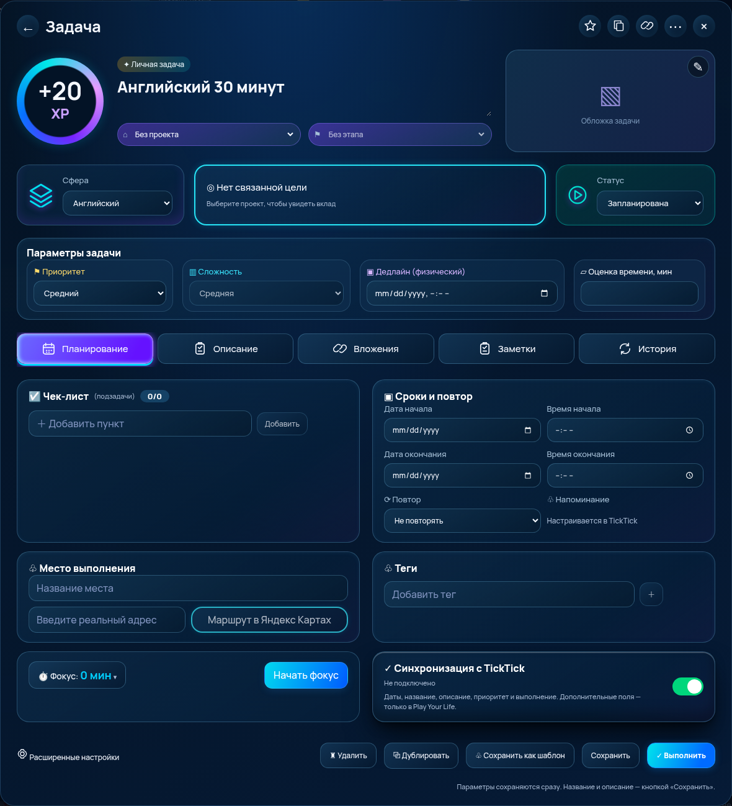
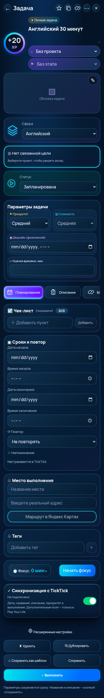

# Окно задачи — 0.81.0, рабочая версия, ещё не принято

Задание: полная переработка окна задачи по ТЗ Ивана и изображению, присланному в чате 11 ноября 2026. Макет — визуальный ориентир, его демонстрационные проценты, адрес, название и картинка не записываются в данные игрока.

## Аудит и исходная точка

Ветка `codex/task-neon-window` создана от свежего `origin/main`: `b01c2eafb5a193aff9ee2c36d34446f092bdf83b` (0.80.4). До изменений рабочее дерево было чистым. Для отката использовать исходный коммит или revert коммита этой ветки, не переписывая историю.

- React 19, Vite, TypeScript. Прямой маршрут задачи — `#/tasks/<id>` (`taskRoutes.ts`), а не серверный `/tasks/<id>`.
- Окно используется из `QuestBoard`, `GoalWorkspace` и `App`. Создание/расширенные настройки — `QuestWizard` → `TaskCreationForm`.
- Модель — `Quest` в существующем `GameState`. Сохранения — localStorage локальной игры и `AccountSave`/Firebase авторизованной игры, проверка `stateValidation`/`questValidation`, большие обложки выделяются существующим `cloudSplit`.
- Цели, этапы, диапазоны и блокировка наград — `planning.ts`, `taskSettings.ts`, `personalQuests.ts`. XP/coins и выполнение — прежние сервисы, не новые обработчики.
- Прогресс — `goalProgressValue`: весовой по задачам без этапов, усреднение прогресса этапов при наличии этапов, отдельный ручной режим. Поэтому прогноз рассчитывается тем же движком на состоянии с выполненной задачей; сумма долей задач и агрегирование этапов не подменяют друг друга.
- Фокус — `FocusSection`/`focusSessions.ts`, текущая сессия в `GameState.focusSession`, подтверждённые сессии — существующие события времени.
- Планирование — `startsAt`/`dueAt`, `repeat`, `subtasks`, `planning.workflow`, приоритет. Старая пара `deadlineAt`/`dueAt` имела разные назначения; новый экран использует только физический `dueAt`. Старое значение `deadlineAt` не удалено из резервных копий и не мигрировано в срок автоматически.
- До изменения не было отдельной модели заметок, места, тегов и раздела файлов задачи. Не создавалась параллельная система задач.

## Изменения

- `TaskWindow.tsx/.css`: шапка, один XP-индикатор, проект и зависимый от него этап, обложка справа, один селектор сферы, объединённый прогресс/вклад/прогноз, статус, четыре параметра, пять вкладок, двухколоночное планирование и адаптивный экран. Реальные пустые состояния.
- Сохранение параметров выполняется сразу прежним `updateTaskSettings`; название/описание — по кнопке. Незавершённые тексты пунктов/тегов/заметок защищены подтверждением выхода и `beforeunload`. Сообщение сохранения не выдаётся за подтверждение записи Firebase.
- Чек-лист: добавление, редактирование, отметка, возврат, удаление, drag-and-drop и кнопка перемещения вверх для сенсорного/клавиатурного доступа.
- Проект: валидация прежним `saveTask`, очистка этапа при переносе, обновление кеша прогресса обоих проектов. Сфера проекта и ограничения уже начатой награды сохранены.
- Приоритет «Критичный» хранится совместимым сочетанием `priority=high` и `planning.urgent=true`; TickTick получает существующий высокий приоритет.
- `Quest.details` — необязательное расширение: `place`, `address`, координаты, `tags`, `notes`, `attachments`, `coverHidden`. Старые сохранения не требуют миграции. Валидация при изменении и восстановлении.
- Заметки имеют собственный ID и дату изменения. До 50 заметок по 2000 символов. Теги без дубликатов с учётом регистра, до 30 по 50 символов.
- Фотографии: существующий валидатор сигнатур/размеров и сжатие, максимум 5 МБ исходного растрового файла, до 40 МП, до 10 вложений, суммарная длина URL вложений до 350000 символов. Сохраняется уменьшенная копия, не оригинал. Доступ ограничен тем же сохранением/аккаунтом; отдельное публичное файловое хранилище не создано.
- Вложения: фото/HTTP(S)-ссылки, фильтры, просмотр, скачивание сохранённого фото, удаление и выбор обложки. Временные blob URL не сохраняются. Файловая загрузка PDF/документов не реализована.
- `TaskDescription.tsx`: безопасный поднабор Markdown (абзацы, списки, заголовки, выделение, код, HTTP(S)-ссылки, изображения). HTML не вставляется в DOM.
- В историю добавляются реальные изменения с `sourceId` и нулевым XP. Старые неизвестные события не реконструируются. Выдача наград не менялась.
- Сохраняемый шаблон сейчас является JSON-экспортом без выполнения, наград и истории; внутренней библиотеки шаблонов нет.
- `TasksCalendar.css`: устранено переполнение меню режимов задач на планшете.
- Проверочный режим `?local-preview=1` открывает существующую локальную игру без Firebase/онбординга. В production/main он не обходит вход; предохранители проверены отдельными unit-тестами и браузером на обычной production-сборке. Не подгружает личный аккаунт и не является проверкой реальной облачной записи.

## TickTick: проверенное состояние слоя приложения

| Данные | Фактическая поддержка |
| --- | --- |
| Название, описание, дата/время начала и окончания, приоритет | Существующий двусторонний обмен |
| Выполнение/возврат, удаление | Существующий обмен с защитой ранее выданной награды |
| Проект/этап, оценка времени | Добавляются как текст в служебный блок описания, не как отдельные поля TickTick |
| Повтор | `repeatFlag` читается, дополнительное правило сохраняется; локальный `repeat` обратно не отправляется |
| Чек-лист, теги, место, отдельные заметки, вложения | В текущем мосте не синхронизируются |
| Изображения | Предпросмотр доступных Markdown-изображений описания; первое может быть производной обложкой. Закрытые вложения/файловый API не подключены |

Статус берётся из `TickTickContext`: подключение, выполняющийся обмен, последняя ошибка, очередь/отличие `localFingerprint` от сохранённого link.local и частичная поддержка. Время успешного обмена — существующее время соединения, не выдуманная индивидуальная метка задачи. Ручная обложка не заменяется автоматически; удаление блокирует автоматический выбор.

Живой OAuth-обмен не проверялся: в среде нет настроенного аккаунта/секретов TickTick. Проверен существующий браузерный сценарий с изолированными mock-сервисами. Страница официального Open API `https://developer.ticktick.com/docs#/openapi` вернула 404 через доступный веб-инструмент: отсутствие поля в мосте нельзя трактовать как доказательство отсутствия поддержки в самом TickTick API.

## Яндекс Карты

Маршрут формируется по сохранённому адресу или валидным координатам: `https://yandex.ru/maps/?rtext=~<destination>&rtt=auto`. Пустой/слишком короткий адрес выключает кнопку; строка назначения кодируется. Это HTTPS-ссылка: решение об открытии установленного приложения выполняет ОС/браузер, иначе остаётся веб-версия. Явная проверка установленного мобильного приложения не выполнена. Геокодер не подключён; существование введённого адреса автоматически не подтверждается.

Документация/пример команды Яндекс: https://yandex.ru/blog/mapsapi/kak-sformirovat-ssylku-na-yandeks-karty . Проверены URL-параметры с реальным публичным адресом тестового сценария, не с вымышленным местом пользователя.

## Запуск и проверяемая страница

```sh
cd /workspace/play-your-life
npm ci
npm run dev -- --port 5173 --strictPort
```

Node 24, порт 5173. Прямая ссылка: http://localhost:5173/?local-preview=1#/tasks/english-1 . Это локальный сервер среды, не публичная ссылка; задача — существующая стартовая локальная задача. Состояние хранится в браузере этого устройства. Для личных данных нужен обычный Firebase-вход без `local-preview` и ID задачи из своего аккаунта. Production-конфигурация и production-сайт не менялись.

На своём компьютере localhost будет работать после запуска этой ветки там; внутри облачной среды — в её браузере/Desktop. Vercel автоматически создал preview ветки. Прямая ссылка проверочного режима: https://play-your-life-git-codex-task-neon-window-play-your-life.vercel.app/?local-preview=1#/tasks/english-1 . Адрес взят из комментария Vercel к PR, не придуман. Внешнюю страницу из исполнителя открыть не удалось: сетевой прокси возвращает `CONNECT 403`. Не объявлять её доступность проверенной.

Сборка с `VERCEL_ENV=preview VERCEL_GIT_COMMIT_REF=codex/task-neon-window` открыта локально через `vite preview` на 5198: прямой маршрут, вкладки, редактирование и перезагрузка прошли, аккаунт не требуется. Обычная production-сборка с тем же URL-параметром отдельно проверена: остаётся экран входа. Условие ограничено именно этой preview-веткой, а не всеми Vercel/production-сборками. В проверочном режиме CloudGame не монтируется даже при ранее существовавшем сеансе; выход из него удаляет флаг из URL.

## Проверки

- `npm run check` — результаты окончательного запуска фиксируются в отчёте ниже.
- `npm test` — полный набор, включая математику и валидацию расширения; результаты окончательного запуска ниже.
- `tests/task-window-ui.mjs`: прямой маршрут, 360/390/768/1024/1440/1920, отсутствие горизонтального переполнения окна/страницы, вкладки, редактирование/перезагрузка, проект, статус, приоритет, чек-лист, теги, отдельные заметки, история, безопасность HTML, ссылка маршрута, фото и обложка после перезагрузки.
- Существующие `quests-ui`, `planner-ui`, `tasks-calendar-ui`, `goals-ui`, `focus-ui` и `ticktick-flow-ui` выполнены; результаты ниже. Удалённые по ТЗ UI зависимостей/ручной ввод факта в тесте планировщика заменены подготовкой через прежние сервисы; защита зависимостей остаётся в модели и тестируется без возвращения запрещённого блока в окно.
- Снимки: `work/task-window/desktop.png` и `mobile.png`. Визуально сверены композиция, цвет, XP-кольцо, обложка, карточки, вкладки и адаптивность. Точного попиксельного совпадения нет: иконки SVG, типографика приложения Manrope, нативные select/date/time и реальные пустые данные отличаются от художественного макета.
- Общий Chromium: попытка открыть ссылку через CUA/Native UI завершилась ошибкой AT-SPI, поэтому браузерные проверки выполнены автоматическим Chromium/Playwright. Не выдавать эту проверку за успешное управление Desktop.

## Осталось для полного закрытия ТЗ

1. Перенести первичную форму создания/расширенных настроек `TaskCreationForm` на ту же композицию; пока сохранена существующая рабочая форма, проверенная регрессиями.
2. Серверное файловое хранилище оригиналов/произвольных документов и авторизованная выдача файлов TickTick. Сейчас доступны уменьшенные фото и ссылки.
3. Напоминания задачи: новое окно не создаёт фиктивное локальное уведомление; показана настройка в TickTick. Надёжная доставка требует интеграционного/серверного исполнения.
4. Полноценная библиотека шаблонов вместо текущего JSON-экспорта.
5. Геокодирование, гарантированный запуск установленного приложения Карт и проверка на реальном мобильном устройстве.
6. Живой TickTick/Firebase-сеанс и проверка облачного сохранения новых метаданных реальным аккаунтом. Подтверждена локальная сериализация/валидация и mock-обмен.
7. Полное совпадение с макетом и пользовательское принятие. Сам макет существует в переписке, исходного файла в репозитории нет.
8. Черновик PR [#314](https://github.com/vodolivan95/play-your-life/pull/314) создан через GitHub connector. Git push работает; GitHub CLI API возвращает Forbidden. GitHub Actions для точного SHA проверяются отдельно в PR. Слияние/production не разрешены.

Полностью технически завершённым всё ТЗ не объявляется.

## Итог выполненных локальных проверок

- `npm run check` — успешно: ESLint без предупреждений, TypeScript приложения/моста, production Vite build. Существующее предупреждение Vite о чанках более 500 КБ остаётся.
- `npm test` — **619/619**, 0 ошибок. Первоначальные замечания к стилю шрифта, подключению нового UI-теста в CI и единой версии устранены; окончательный полный запуск зелёный.
- `npm run check:budgets` — вес сборки в пределах установленного бюджета.
- `test:quests-ui` — ПК/телефон: создание, фото-preview, лимиты, блокировка, награда, привычка, поиск, перезагрузка.
- `test:planner-ui` — ПК/телефон: план/факт с реальной моделью сессии, недельное планирование, переносы, модель зависимостей, обзор.
- `test:tasks-calendar` — успешно.
- `test:goals-ui` — 1440/768/390/360: URL, этапы/задачи, календарь, общая форма, весовой прогресс, награды, перезагрузка, предел 100%.
- `tests/focus-ui.mjs` — 1440/390: запуск, пауза, перезагрузка, продолжение, однократное сохранение времени.
- `tests/ticktick-flow-ui.mjs` — успешно; только mock-сервисы, не живой TickTick.
- `tests/task-window-ui.mjs` — шесть ширин и перечисленные выше действия; дополнительно выполнение, возврат в «В работе» и повторное выполнение без второго начисления XP. JS `pageerror` отсутствуют.
- Скриншоты Desktop/Mobile созданы. Выделенная внешняя папка `/codex/.../output` в этом исполнителе недоступна для записи (read-only root), поэтому снимки остаются в `work/task-window/` и выводятся в чат как изображения; в CI предусмотрен upload-artifact этой папки.

## Скриншоты рабочего окна

Сняты в изолированной локальной игре с её существующей стартовой задачей. Отсутствующие обложка, сроки и цель показаны пустыми, а не заменены данными макета. Проверка загрузки фото/обложки и выбора проекта выполняется отдельно сценарием UI.

Desktop:



Mobile:



## Дополнительная сверка дизайна кнопок

По уточнению Ивана выполнена [полная сверка элементов управления](TASK-BUTTON-DESIGN-AUDIT.md). Исправлены SVG-иконки и размеры верхних действий, семантика вкладок, контур/тип селекторов, цвет приоритета, добавление пункта и тега, компактный редактор места, отдельная кнопка карты, двухстрочный маршрут, фокус/план/факт, переключатель TickTick и нижняя панель. Проверены переключение двух обложек, избранное, оценка времени, дублирование, скачивание шаблона, отмена и подтверждение удаления. Не подключённые напоминания остаются явно отключёнными.

Добавлены `taskReviewMode.ts` и предохранитель в `vite.config.ts` для изолированного просмотра именно этой Vercel Preview-ветки. Новые тесты запрета production-обхода довели общий набор до 618. Полный внешний TickTick/Firebase-сеанс не проверен.

## Установка браузера в CI

Для коммита сверки кнопок базовый CI job `check` (сборка/бюджет/618 тестов) и Firestore прошли. Браузерные задания зависли до тестов на `playwright install --with-deps`: `Temporary failure resolving azure.archive.ubuntu.com`; job города был отменён по 10-минутному лимиту. Лог подтвердил, что все shared libraries Chromium уже есть в hosted Ubuntu, отсутствовали только дополнительные наборы шрифтов. CI теперь скачивает закреплённый Playwright Chromium командой `npx playwright install chromium`, используя системные библиотеки образа и Manrope проекта. Никакие тесты или проверки результатов не пропускаются; отсутствие runtime-библиотеки по-прежнему приведёт к реальной ошибке запуска браузера. Новый итог CI проверяется отдельно для последнего SHA.

## Дополнительные регрессии после полного CI

- Тест сферы обновлён под вкладку «Описание» и явное сохранение; прежний поиск поля «Комментарий / заметка» больше не соответствует интерфейсу. Вход в окно из сферы теперь также передаёт существующие обработчики выполнения и дублирования, как остальные точки входа. Сценарий проверяет повторное выполнение без второго XP и дублирование из сферы.
- Issue [#315](https://github.com/vodolivan95/play-your-life/issues/315): в существующем `duplicateQuest` имя копии ограничено 100 UTF-16 символами вместе с суффиксом без разрезания эмодзи/графем. Исходная задача не меняется; игровая экономика не менялась. Новый регрессионный тест проверяет сериализацию/validateState, общий набор — 619.
- Общий UI-обработчик дублирования защищает от двойного клика; таймер защиты очищается. При исчезновении открытой задачи (например, после обмена) снимается блокировка прокрутки. Это проверяется отдельным сценарием изменения состояния, не выдаётся за живой TickTick-сеанс.

Асинхронная загрузка фото сливает метаданные с актуальной задачей, чтобы не удалять заметки, добавленные во время декодирования. Регрессия удерживает декодирование изображения, сохраняет новую заметку и проверяет её после завершения загрузки.

## Исправление сложности 0.81.1

По замечанию пользователя устранена ошибочная блокировка старых/стартовых задач без `sourceType`. Отсутствующий признак не приравнивается к явному `SYSTEM`; завершение, начатый прогресс и фиксация награды по-прежнему запрещают изменение. Причина блокировки показана рядом с полем. В браузере проверяются пять уровней и перезагрузка; unit-тест проверяет неизменность начисленного XP.

## Согласованная композиция 0.82.0

Иван поручил использовать первый утверждённый макет, заменить только фокус вариантом со второго изображения (таймер + ручное время) и слить. Следующий шаг, таймлайн и другие дополнительные блоки из отдельного прототипа не переносятся.

FocusSection отображает один план/факт и одну текущую сессию. Кнопка «Записать время» открывает нативное модальное окно (часы, минуты, дата не позже сегодняшней, комментарий до 300 символов). Факт считается существующими focusRecords/taskFocusSeconds из planning/time событий. Необязательное поле comment добавлено в валидатор старых ручных записей; старые записи остаются совместимыми. Таймерные сессии, XP и план не меняются. Исправление ручной записи заменяет минуты вместо прибавления и проверяет исходную версию при конкурентном изменении; удаление сохраняет событие как аудит без planningChange, исключая его из всех сумм. Общая панель свёрнутого таймера скрывается при открытом окне задачи, чтобы не дублировать фокус.

Issue #316. Живой Firebase/TickTick-сеанс не проводился; проверены сериализация/валидация и браузерные сценарии. Прежние ограничения произвольных файлов/напоминаний/библиотеки шаблонов сохраняются.
